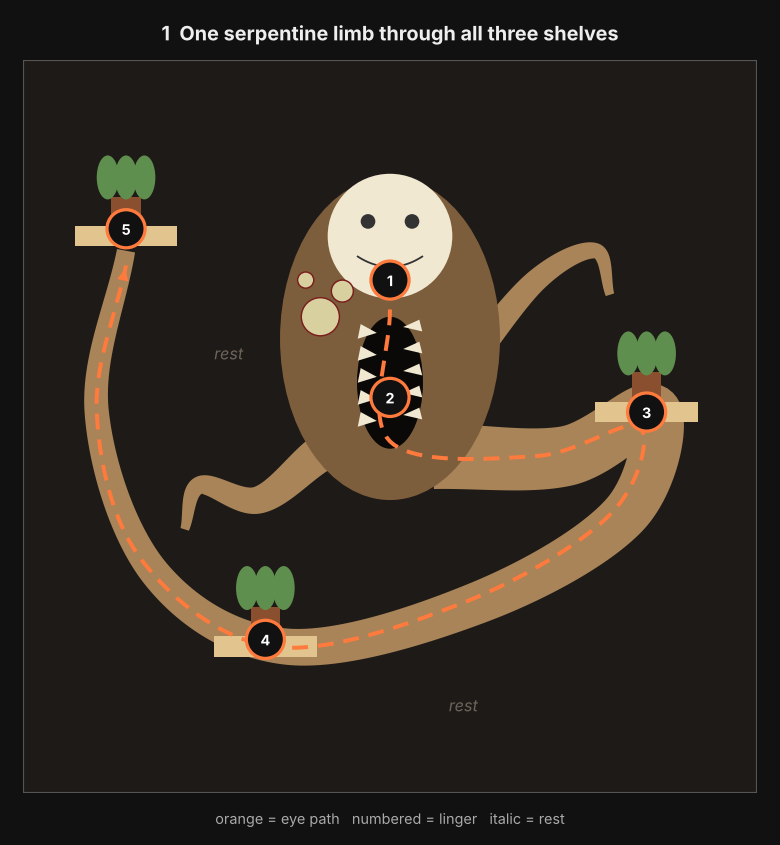
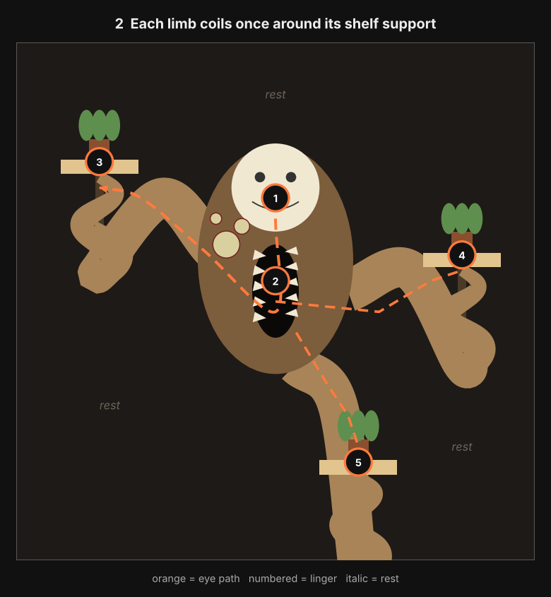
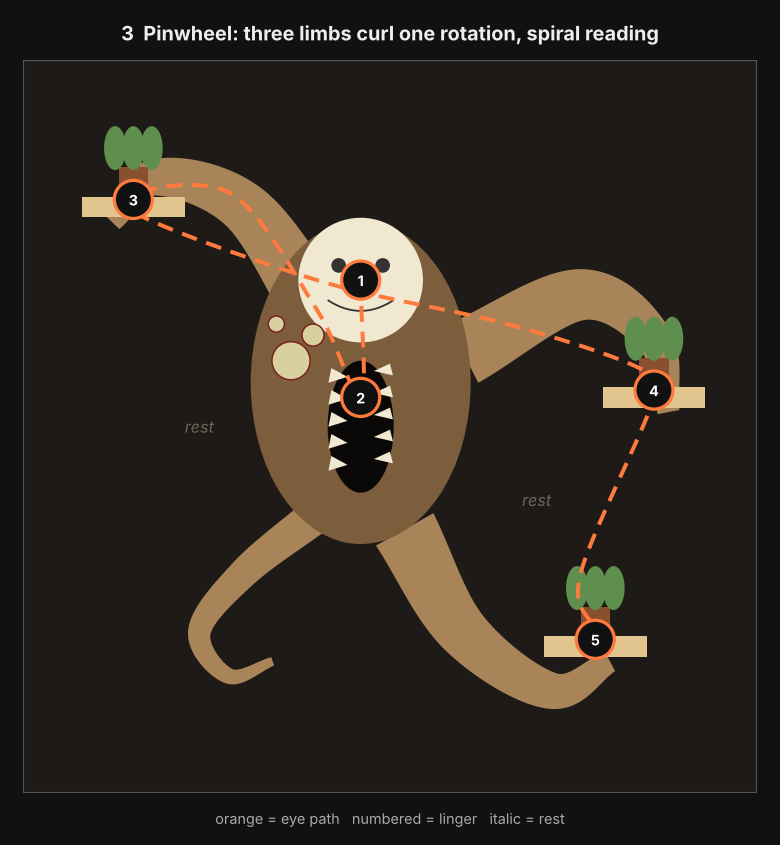
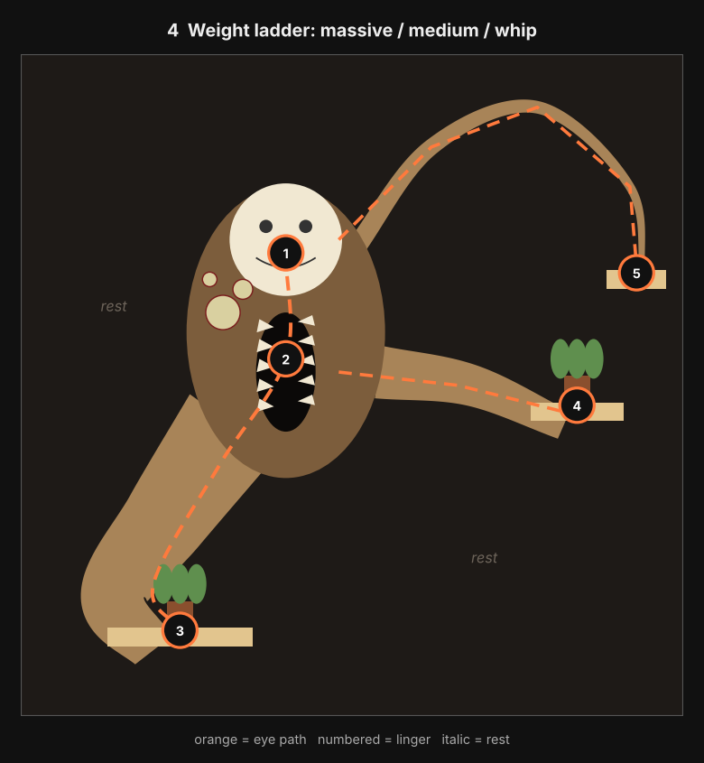
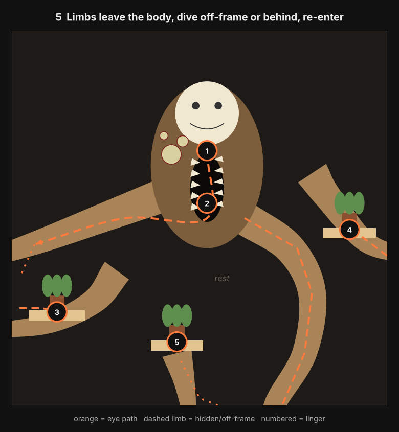
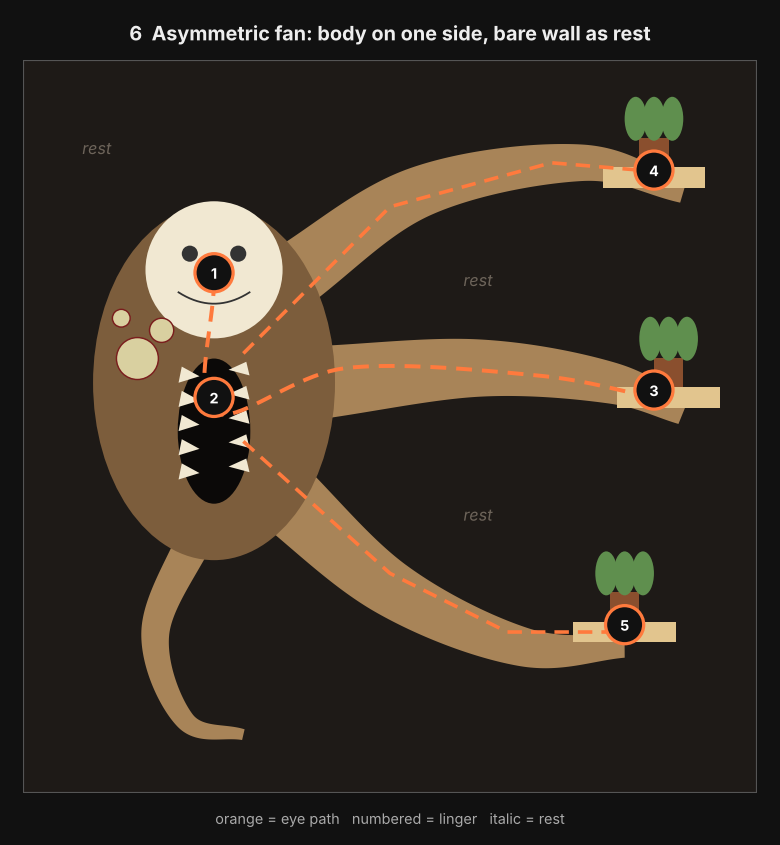
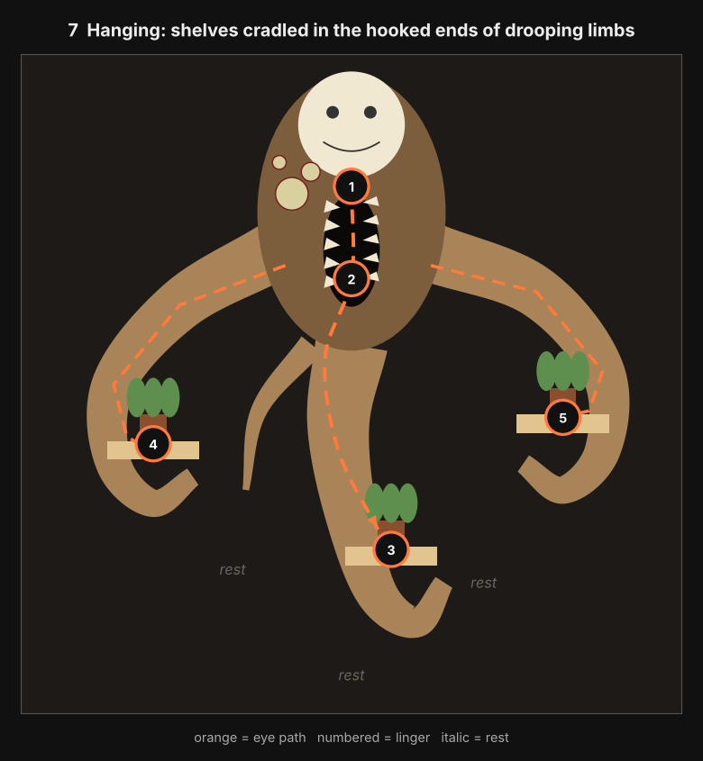
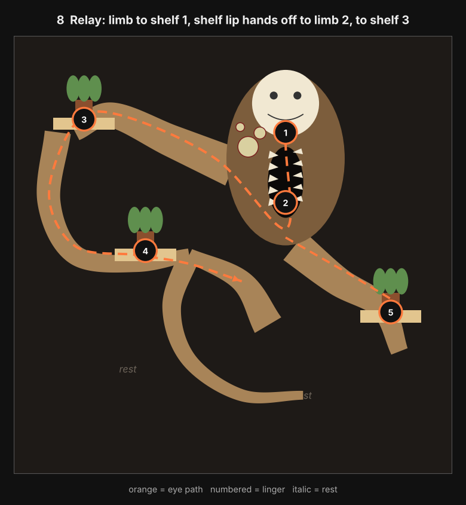
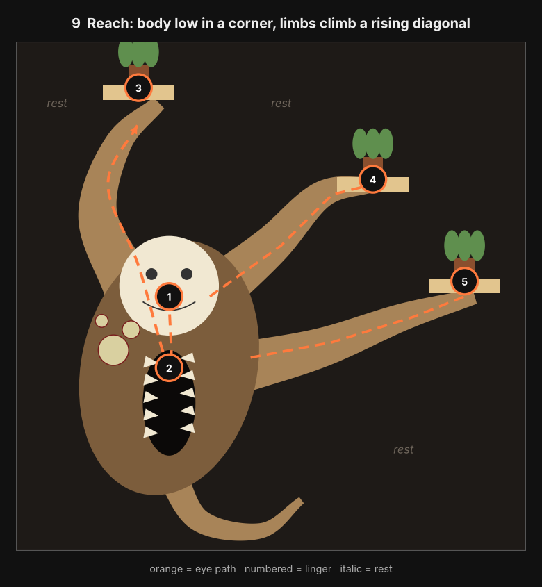

# Round-09 brainstorm: three distinct tentacles, uncrowded

Paper only. Sits beside Evan's sketches; his sketches override anything here. Diagrams in `round-09-brainstorm/` (flat shapes, rough on purpose; regenerate with `python3 -I make_diagrams.py`). Nothing here is a spec or a verdict.

## 0. Brief, from Evan r08 (verbatim anchors)

- "do not do a crown. it looks comical."
- "the flow visually towards the platforms is underwhelming and i would prefer distinct tentacles."
- "compositionally too crowded ... a thing for the eyes to linger upon and experience every aspect, but this feels like it is rushing to get all the points across."
- Recenter: "tentacled, horrific, and octopus-like with a distinct, vicious mouth and disturbing eyes that have no contract to be symmetrical or healthy."
- Reference direction: not c01 ("try one of the other preferred concepts"). Candidates: c02 stone-smile (loved; one web-flesh mass, limbs are the shelves' own spans, big bare-wall wedges) and c03 mask-plus-maw-ochre (liked; radial octopus, smiley over a toothed maw, three shelf limbs with curled tips).
- Standing locks that still bind these ideas: side-profile relief; vertical maw; no two-legged look; Beksinski/gothic; base that could not sit flat on a floor (r07).

## 1. What went wrong in A (read from the render)

- Eight-plus similar parts at one value: 5 horns, 3 shelf spoons, ribbed trunk, 6 root tendrils, torn webbing flaps. No dominant, no rest.
- Shelves sit at the ends of short stubs. The eye gets from the mask to a shelf in one hop with no limb to ride. The limbs that do exist (lower roots) lead away from the shelves, to the bottom.
- Horns around the mask = crown. Delete the whole family: any radial spikes/fins/tendrils closer than ~1 mask diameter around the mask, symmetric or not.
- Roots at the base are many thin ropes of equal weight. "Distinct tentacle" needs size difference between limbs and gaps (wall) between them.

Common moves in every idea below: exactly 3 shelf-bearing limbs, each readable as one continuous object from the body to its shelf at 64 px; at most 1-2 free (non-shelf) tendrils, and those are small; mask is the quiet bright thing, maw is the dark heavy thing, tentacles are the long things; nothing else at tentacle scale.

## 2. Ideas

Legend in all diagrams: orange dashed = eye path; numbered dot = linger point; italic "rest" = deliberate bare wall. Shelf = pale bar with plant. Body shown as plain ellipse; mask and maw are placeholders, off-axis eye cluster is a placeholder.

### 2.1 Serpentine: one limb through all three shelves

- **Eye travel:** mask, down the maw, out along the dominant limb to shelf at right, the limb turns back under the body to the low-left shelf, then climbs the left edge to the top-left shelf. One continuous line, three beats.
- **Linger:** each bend where a shelf sits on the outer curve; the long empty arcs between are the rest (long straight-ish run on the bottom).
- **Horror:** one huge muscle-rope that coils like a snake across the whole wall; the other two limbs are stunted/small, so it reads as an animal with one monstrous arm. Sucker rows and a hooked tip on the final reach.
- **Avoids:** no crown (nothing near the head); no stance (limbs not paired, no feet); it is a loop around bare wall, not legs.
- **Risk:** the limb can read as a vine/border frame around the wall (a frame, not a creature); shelf-in-limb ledges can look like bracket-on-pipe. Highest print mass: one long limb, 1.3 m of run, needs the embedded core. Shelves 2 and 3 become part of the limb: pots weigh on a rope that is also structure.

### 2.2 Coil: each limb coils once around its shelf support

- **Eye travel:** limb leaves the body, runs a clean arc, spirals up the post, lands on the shelf. Three times, three directions.
- **Linger:** at each coil (the tightest, most detailed spot), then the plant.
- **Horror:** the shelf is held by something that has grabbed it: it is prey, a perch, a captured thing. Plant-as-trophy.
- **Avoids:** crown none; limbs come off the body at different heights and angles.
- **Risk:** reads as ivy on a trellis or a barber-pole; posts are extra vertical structure, not in c02/c03; three identical coils = repetition. Mitigation: vary coil count (1, 1.5, 2) and thickness. Posts could be bone or a spar already printed as part of the wall relief (check CAD: coil gaps are undercuts).

### 2.3 Pinwheel: spiral reading order

- **Eye travel:** mask, maw, then the three limbs all curl the same rotation (clockwise here), so the eye keeps swinging round the body: top-left shelf, right shelf, low-right shelf. Reads as a rotating organism.
- **Linger:** the centre (mask and maw), then each tip curl before the shelf.
- **Horror:** the whorl of a drowning whirlpool; vortex around a mouth is the lamprey/sarlacc logic.
- **Avoids:** crown: keep the first limb leaving the body well below the mask, never a ring of them. Not two-legged because limbs are not a pair.
- **Risk:** closest to c03 and to a pinwheel/sun logo (cute). Hold the weights unequal and the curl direction slightly broken (one tip counter-curls). Radial layout was liked (r05) but is only conditional.

### 2.4 Weight ladder: massive, medium, whip

- **Eye travel:** heaviest limb grabs attention first (big dark mass, big shelf), the medium limb is a second beat, the whip (thin, 1 m reach, tiny shelf) is a late discovery that rewards looking.
- **Linger:** the massive limb's shelf (large, high-detail), then a long travel along the whip.
- **Horror:** scale contrast = animal anatomy; whip with a hook/barb tip is the stinger. Different silhouettes, so "distinct".
- **Avoids:** crown none; no pair, since limbs are not matched. Not a stance: the massive limb sweeps off to a corner, not down.
- **Risk:** the whip is the weakest print element (needs a >= 8-10 mm core, see structural rules) and the third shelf on a whip holds the lightest pot only; the massive limb unbalances the wall (centroid left-low). Counter: whip goes high, massive goes low.

### 2.5 Exit and re-enter

- **Eye travel:** limbs leave the frame or dive behind the body and re-emerge elsewhere carrying a shelf. Eye follows to the edge and hops across rest wall to where the limb returns (closure/Gestalt).
- **Linger:** at the exits and returns; the wall between is the rest.
- **Horror:** the creature is bigger than the piece: only parts of it are in this room (Lovecraft scale cue). The "base that would not sit flat" is satisfied by limbs going off the edge.
- **Avoids:** crown none; stance none.
- **Risk:** a relief with a defined envelope (914 mm, segmented): limbs that exit are cut off at the edge and need clean terminations; a re-entry limb with no visible source may read as a separate object ("floating island", fails DESIGN_PRINCIPLES 1.8 G64 test). Use a hidden-behind-body version first, edge-exit second. Dashed ghost segment in the diagram marks the implied part.

### 2.6 Asymmetric fan

- **Eye travel:** body off to one side; three limbs fan across the wall to the far side in a staggered cascade; eye sweeps across the whole width, one beat per shelf, at three different heights.
- **Linger:** the face (alone on its side), and each tip; the big wedges of bare wall between limbs are the rest (the c02 wedge logic).
- **Horror:** watched across a room; empty half is the unease. A face looking along its limbs at the wall.
- **Avoids:** no crown (limbs go out one side only). Not two-legged: three limbs, different lengths, one direction.
- **Risk:** the three diverging limbs can read as a hand/claw or a rake. Break parallelism: two up, one down, with different curl. Piece envelope gets lopsided; centroid test (|offset| <= 8%) may fail, so the body must be heavy to compensate.

### 2.7 Hanging: shelves cradled in drooping limbs

- **Eye travel:** body high; limbs sag down and hook back up under shelves like a cradle. Gravity does the leading: eye falls from the mask, down a limb, lands in the hook.
- **Linger:** the hook (the cradle is the strongest form on the piece), the pot above it.
- **Horror:** dead-weight, dripping, medusa-on-a-ceiling; viscous slackness. Octopus on a rock, pulled off the wall.
- **Avoids:** crown none (limbs leave below the mask). Two-legged risk is real here: two drooping limbs flanking a central one = a stance. Vary: left limb short and hooked, centre long, right limb thick and slumped.
- **Risk:** symmetrical danger; it also reads as jellyfish / medusa. Heavy visual weight low, light at top: fine for a wall piece but body can look like it is hanging, not growing. Structural: drooped limbs hold nothing by themselves, shelf load goes through the hook.

### 2.8 Relay: shelf-to-limb hand-off

- **Eye travel:** limb 1 to shelf 1, shelf lip is where limb 2 begins (tendril sprouts from the cup edge) and runs on to shelf 2, and so on. The eye never has to jump through wall.
- **Linger:** each handoff, where limb and shelf overlap.
- **Horror:** the plants are being "grown" by the creature: parasitic spread, vein-like; the shelves are organs not furniture.
- **Avoids:** crown none; stance none.
- **Risk:** weakest octopus read; turns into branching tree/vine (Evan wants "octopus-like"). Hand-off limbs might be too thin to count as "distinct tentacles". Use as a secondary link only, not as the primary structure.

### 2.9 Reach: body low, limbs climb a diagonal

- **Eye travel:** body in the lower-left corner; mask looks upward; the three limbs step up and out, one shelf per step, along a rising diagonal. The eye climbs.
- **Linger:** maw (heavy low mass, big and dark), then the topmost shelf (the finish).
- **Horror:** a thing hauling itself up the wall; the wall is a surface it is climbing, so the artwork "will not sit flat" (matches r07 floor-base ask). Mask reads as stalking.
- **Avoids:** crown none: limbs leave below and beside the mask; stance none, as the limbs reach up and out, not down.
- **Risk:** diagonal composition was liked (r07 G2a) but the body must stay a defined organism; top-left limb reaching up beside the head is the one near crown geometry: keep it 1.5+ mask diameters off and give it a clear root lower than the mask centre.

### 2.10 Quick comparison

| # | Idea | Distinctness | Rest | Octopus read | Print risk |
|---|------|--------------|------|--------------|------------|
| 1 | Serpentine | one dominant | high | medium (snake) | high |
| 2 | Coil | even | medium | medium | medium (undercuts) |
| 3 | Pinwheel | medium | medium | high | low |
| 4 | Weight ladder | highest | high | high | medium (whip) |
| 5 | Exit/re-enter | high | high | medium | medium |
| 6 | Asym fan | medium | highest | high | low |
| 7 | Hanging | medium | medium | medium (medusa) | medium |
| 8 | Relay | low | low | low | medium |
| 9 | Reach | high | medium | high | low |

Combinable: 4 + 6 or 4 + 9 (weight difference on a one-sided fan or a climb) answers all three asks (distinct, less crowded, flow) with the fewest new risks. Idea 3's rotational curl and 2's single coil on one limb are cheap accents on any of the above. Own view only; Evan's sketches win.

## 3. Uncrowding rules of thumb (for any idea)

- Part budget: body mass, mask, maw, eye cluster, 3 shelf limbs, <= 2 minor tendrils. Anything else must be texture, not form.
- Three sizes only (big body/limb, medium shelf/maw, small eyes/teeth), per DESIGN_PRINCIPLES 1.3.
- Wall wedges: at least three bare-wall regions each >= a mask diameter across; one of them large (c02 left wedge).
- Detail budget: lowest on shaft mid-spans, highest at the maw, eyes, and each limb tip. A slow reading speed is made by long quiet shafts between dense nodes.
- Reading order at 3 m: mask, maw, longest limb, shelves; the second reading at 1 m is texture, eye detail, suckers.

## 4. Mouth: ideas, not specs

Existing build spec (feature-references s.2: vertical almond, 1:1.5, ~1.0-1.15 D wide, two-row blade teeth) stands as a baseline. These are directions to widen it; "vicious, distinct" needs an archetype, not a better ring.

- **Lamprey ring, but a slot:** concentric tooth rows spiralling in, but the opening vertical and split at the bottom (a seam): the ring opens like a flower on one side only. Retains radial funnel depth.
- **Anglerfish hinge:** huge gape, thin hinged needle teeth angled inward, upper jaw slightly offset from lower (jaw is crooked). A single long front fang that can't close behind the lip.
- **Deep-sea (viperfish / goblin shark):** parabolic mouth, a few overlong teeth that poke outside the lip, not a full set. Fewer, longer teeth is more disturbing than many.
- **Carpenter's Thing chest-mouth:** the maw is torn into the body, not set in a lip ring: split flesh, wet, irregular teeth embedded in tissue, tendrils of flesh across the opening (careful: Evan said drop strands; use flesh sheets/folds at the corners, not threads).
- **Bloodborne beast-jaw:** heavy gums, long uneven fangs, a lower jaw hanging at an angle.
- **Beak option (octopus):** a parrot beak at the centre of the maw, tooth rows around it: the most "octopus-like" mouth, and not a cliché. Test whether it fights "smiley mask over a mouth".
- **Tentacle-lipped:** the lip itself is 3-5 short muscular arms folded in (octopus buccal mass); opens like a flower in the vertical slot.
- **Rule for all:** one dominant feature (the longest fang, the beak, the crooked jaw), the rest is support. A mouth that is "distinct" has an off-axis asymmetry you can name.

Interaction with the smiley: mask grin above a maw is a rhyme (two mouths). Let the maw be heavier, darker, off-centre by a few percent; the mask stays flat and calm.

## 5. Eyes: ideas, not specs

Evan: "no contract to be symmetrical or healthy". Existing spec: cluster of 3-7 unequal globes, <= 12 total (feature-references s.3).

- **Off-axis cluster, not a pair:** one big globe, a medium one touching it, 2-3 small ones trailing down a ridge toward the maw. Whole cluster sits on one side of the mask. Eyes are not on a horizontal axis.
- **Non-matching:** sizes at ratios like 3:1.7:1; one eye much larger than the others; lid states differ (one retracted, one hooded, one fused shut).
- **Unhealthy:** one clouded (cataract, milky, pupil lost); one bloodshot with vein reds painted (veins < 1 mm do not print: paint or deep etch); one ulcered or weeping (a dark drip channel under it); one scarred shut with a seam.
- **Displaced:** an eye on a tentacle shaft near a shelf (watches the plant), one inside the maw rim, one on the shelf arm; careful: stray eyes = clutter, max 1-2.
- **Wrong pupils:** one horizontal slit, one pinpoint, one blown wide; gaze vectors not parallel, one rolled up to the lid.
- **Socket variations:** one on a turret mound, one sunken in a bone socket, one half-embedded in flesh: not a sticker.
- **Placement logic:** the eye cluster is the secondary read and sits between mask and maw on one flank so that the eye path 1 to 2 passes through it. Do not duplicate it on other limbs in force.

## 6. Questions to hold up against Evan's sketches

Single page. Tick each against every sketch; answers feed the round-09 brief.

1. **Count the limbs.** Exactly three carrying shelves? Any extra free tentacles? How many? (A had 6+.)
2. **Hierarchy of limbs.** Are the three equal, or is one clearly heaviest and one lightest? Which goes where?
3. **Path.** Trace a finger from the mask. Does it go mask, maw, shelf by shelf without a gap? Where does it stop or hop through wall? Is the order one he wants (clockwise, descending, rising)?
4. **Do the limbs overlap or cross?** Is any limb behind another, behind the body, or off-frame? Do they touch each other?
5. **How do shelves attach?** On the limb, at the tip, cradled in a hook, on a post? Is the shelf a flattened terminal of the limb, a separate bracket, or wrapped by it?
6. **Body position.** Centred, off to one side, low in a corner? Which way is the head facing? Is the body large and defined or small?
7. **Pose gravity.** Rising, hanging, reaching, spread? Is any left/right pair of limbs mirrored? Does it risk "two legs"?
8. **Rest.** Where is the empty wall in the sketch? How big? Is any area intentionally quiet?
9. **Mask.** Size relative to the body; does anything come near it (crown risk)? Is it centred on the body or off-axis?
10. **Maw.** Vertical or other? Which archetype does the sketch lean toward (lamprey, anglerfish, beak, chest-wound)? Asymmetry? Is it the heaviest dark thing?
11. **Eyes.** How many, where, same size? Anything clouded or displaced? On the face or on limbs?
12. **Texture/surface.** Any area he marked as detailed vs plain? Suckers: yes or no, which limbs?
13. **Base.** Does it read as something that could not sit flat on a floor? Which parts go off the edge?
14. **Envelope.** Does the sketch fit the ~914 mm square, or extend past it (the 3x3 ft vs ~4 ft question is still open)?
15. **What does it do that none of the nine ideas above does?** Record it first; it is the real information.
16. **Which concept family is it closest to:** c02 (web-flesh span) or c03 (radial octopus)? Or neither?

## Edit log

| Date | Agent | Change | Signed-off-by |
|------|-------|--------|---------------|
| 2026-11-17 | aesthetics-analyst | Initial creation: round-09 brainstorm, 9 tentacle-flow ideas, mouth/eye ideas, sketch-comparison questions. [PROVISIONAL] | pending (second-agent sign-off required) |
